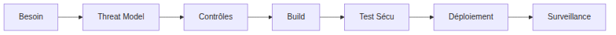

# Formation SecDevOps — JOUR 1 — Introduction et principes de SecDevOps

## Module J1-M1 — Introduction à SecDevOps et à la sécurité agile

### Préambule

Un défaut de sécurité entre dans le code à une date précise, puis reste présent jusqu’à sa détection. Dans l’incident Codecov de 2021, la modification du script de téléversement est restée active environ deux mois avant qu’un client ne la détecte, le 1er avril 2021. Le temps de présence du défaut, et non sa seule existence, détermine le coût de la correction.

Un incident comporte trois dates : l’introduction du défaut, sa détection et sa correction complète. Plus l’écart entre l’introduction et la détection, puis entre la détection et la correction, s’allonge, plus la correction coûte cher. SecDevOps ne vise donc pas à ajouter des comités, mais à réduire ces délais par des contrôles automatiques.

La chaîne de livraison détient des identifiants, exécute du code de tiers et échange avec un registre d’images, le dépôt qui stocke les images de conteneur. Si un attaquant la compromet, il peut publier des images malveillantes avec ses droits. Elle est donc le lieu le plus utile pour contrôler, et une cible à protéger.

### Le vocabulaire en clair

| Terme | En clair | Où on le rencontre |
| --- | --- | --- |
| DevOps | Pratique qui réunit l’écriture du logiciel et son exploitation, avec un pipeline automatisé entre les deux. | Tout le module. |
| SecDevOps | Même pratique, avec la sécurité traitée comme exigence de conception et vérifiée à chaque changement. | Les huit modules. |
| Pipeline | Suite automatisée du commit à la mise en service : construire, tester, publier, déployer, surveiller. | Le `Jenkinsfile` du lab. |
| Contrôle bloquant | Contrôle dont l’échec arrête la livraison : l’artefact ne sort pas, la fusion est refusée. | Grille du lab, [J1-M2](#module-j1-m2--contrôles-de-sécurité-dans-les-pipelines-devops). |
| SAST (Static Application Security Testing) | Analyse du code source sans l’exécuter, à la recherche de motifs dangereux. | Module [J2-M1](jour-02.md#module-j2-m1--automatisation-des-tests-de-sécurité). |
| SCA (Software Composition Analysis) | Analyse des bibliothèques tierces et de leurs versions face aux vulnérabilités connues. | `requirements.txt`, [J2-M2](jour-02.md#module-j2-m2--gestion-des-vulnérabilités-et-remédiations). |
| Secret | Identifiant, jeton ou clé qui donne un accès ; il se stocke dans un gestionnaire de secrets, jamais dans un fichier versionné. | `Jenkinsfile` du lab. |

### Objectifs du module

À l’issue de ce module, vous serez capable de :

1. **Expliquer** les cinq dimensions du modèle CALMS (Culture, Automation, Lean, Measurement, Sharing) et situer la boucle de livraison dans le cycle de vie.
2. **Distinguer** sécurité traditionnelle, DevOps sans sécurité et SecDevOps sur quatre critères.
3. **Justifier** l’intégration de la sécurité par le coût du retard, les échéances réglementaires et la surface d’attaque du pipeline.
4. **Reconstituer** Codecov 2021 et Log4Shell 2021, puis nommer les contrôles qui auraient interrompu la chaîne d’attaque.
5. **Auditer** une chaîne de livraison en plaçant six contrôles avec leur preuve et **choisir** le référentiel adapté.

**Public et prérequis.** Ce module s’adresse aux développeurs, aux ingénieurs DevOps, aux ingénieurs SRE (Site Reliability Engineering), aux ingénieurs QA (Quality Assurance), aux ingénieurs sécurité et aux chefs de projet techniques. Le niveau attendu est intermédiaire. Les prérequis sont les bases de Git, de la ligne de commande, du pipeline d’intégration continue et de Docker.

### Contenu du module

#### 1. DevOps, CALMS et la boucle de livraison

DevOps réduit le délai entre une modification et sa mise en service, sans dégrader la stabilité, en partageant la responsabilité entre les équipes qui écrivent le code et celles qui l’exploitent. Le modèle CALMS, proposé en 2010 par Damon Edwards et John Willis, décrit cinq dimensions à faire progresser ensemble : chacune répond à une question (culture : qui répond quand la production tombe ; automatisation : quel geste manuel subsiste ; lean : quelle file d’attente ralentit le flux ; mesure : quel indicateur prouve le progrès ; partage : où circule le savoir). Une dimension négligée fragilise les autres.

La chaîne de livraison comporte huit étapes : planifier, coder, construire, tester, publier, déployer, exploiter et surveiller ; la dernière alimente la première. Quatre indicateurs DORA (DevOps Research and Assessment) mesurent ce flux : fréquence de déploiement, délai de changement, taux d’échec de changement et délai de rétablissement. Les travaux DORA observent que les équipes qui livrent souvent échouent moins : elles automatisent davantage leurs contrôles et réduisent la taille des changements.

#### 2. Pourquoi la sécurité arrive en fin de chaîne

Dans le cycle en V, où chaque phase de développement est suivie d’une phase de test, la sécurité n’est vérifiée qu’une fois, juste avant la mise en service. Quatre causes expliquent ce placement :

- **cloisonnement** : l’équipe sécurité ne travaille que sur ticket, et sa réponse arrive en quelques semaines ;
- **asymétrie de compétence** : la sécurité paraît réservée aux experts, et le développeur ne se sent pas légitime pour la traiter ;
- **outillage lourd** : les analyseurs sont lents, leurs licences limitées et leurs rapports arrivent en PDF (Portable Document Format), hors du pipeline ;
- **métriques contradictoires** : la sécurité se mesure au nombre de constats, le développement à la vélocité (quantité de travail livrée par itération).

La sécurité devient alors un point de contrôle unique, placé à la fin du cycle, où la correction coûte le plus. Trois issues sont possibles : retarder le projet, juger le contrôle inutile, ou accorder une dérogation qui laisse passer le défaut. SecDevOps supprime les causes au lieu de déplacer ce point : le contrôle passe d’un comité annuel à chaque commit, le risque passe de l’équipe sécurité à l’équipe produit, et la métrique mesure les délais de détection et de remédiation au lieu de compter les constats.

#### 3. Coût, conformité et surface d’attaque

Le coût d’une correction augmente avec le délai : Boehm a décrit cette croissance par phase du cycle en 1981. Les ratios souvent cités (1, 6,5, 15, puis 30 à 100) ne reposent sur aucune mesure reproductible et omettent la notification, l’indisponibilité et l’atteinte à la réputation ; seul l’ordre de grandeur aide à décider. Le RGPD (Règlement général sur la protection des données) impose la protection dès la conception (article 25) et la notification d’une violation sous 72 heures (article 33). La directive NIS2 (Network and Information Security directive, second version) impose la sécurité de la chaîne d’approvisionnement (article 21), une alerte précoce sous 24 heures et une notification sous 72 heures (article 23). Ces délais supposent une détection en quelques heures et des preuves produites par les outils.

Le pipeline lui-même expose six actifs : le poste de développement (secrets en clair, extensions malveillantes), le dépôt Git (commit direct sans revue), l’agent d’exécution (code externe exécuté avec des secrets), les outils tiers (script amont modifiable, version flottante), le registre (image substituée, étiquette qui change de contenu) et les identifiants de déploiement (souvent sur-privilégiés). Chaque actif reçoit un contrôle de référence : détection de secrets, protection de branche, jetons courts (valables peu de temps), épinglage (figer une version exacte), signature et référence par empreinte (digest), moindre privilège et rotation (remplacement régulier des secrets).

#### 4. SecDevOps, piliers et rituels agiles

SecDevOps traite la sécurité comme une exigence de premier rang, au même titre que la livraison, dans la culture, les processus et l’outillage. Le terme DevSecOps est plus répandu en anglais ; l’ordre des lettres marque un accent, non une différence de fond. Cinq piliers doivent tenir ensemble : le **shift-left** (avancer la sécurité vers le début du cycle) place les exigences et les contrôles dès la conception ; l’**automatisation** rend les contrôles reproductibles et versionnés ; la **collaboration** intègre la sécurité aux rituels de l’équipe ; la **mesure** suit les délais, la couverture et la dette ; l’**amélioration continue** transforme chaque incident en contrôle. Le pilier le plus souvent manqué est le dernier : sans lui, le même incident revient.

En agile, la sécurité s’intègre à cinq rituels existants, sans en créer de nouveau. Le raffinement (préparation des tâches suivantes) reçoit un critère d’acceptation de sécurité. La définition du « terminé » exige une case « contrôles verts ». La revue de code porte sur les entrées, les autorisations, les secrets et la journalisation. La rétrospective ajoute un contrôle, et la revue de sprint présente deux indicateurs de sécurité.

Le modèle des trois lignes de l’IIA (Institute of Internal Auditors, *Three Lines Model*, 2020) répartit la responsabilité. L’équipe produit possède le risque, la fonction sécurité définit les règles et fournit les outils, et l’audit interne apporte une assurance indépendante. La sécurité as code (*security as code*) range ces règles dans des fichiers versionnés, revus et exécutés comme du code applicatif. Une exception sans date d’expiration revient à supprimer la règle sans le dire.

#### 5. Étude de cas et référentiels

**Codecov, 2021.** Une clé HMAC (Hash-based Message Authentication Code, un code d’authentification de message) se trouvait dans une couche intermédiaire de l’image Docker publique de l’offre auto-hébergée. Cette clé permettait de modifier le script de téléversement (uploader) fourni aux pipelines. Le script modifié exfiltrait les variables d’environnement du build : clés d’API (Application Programming Interface), jetons de déploiement, identifiants de registre. Un client a détecté l’anomalie le 1er avril 2021 en comparant l’empreinte SHA-256 (Secure Hash Algorithm, 256 bits) du script, soit environ deux mois après le début des modifications.

**Log4Shell, décembre 2021.** Dans Apache Log4j 2, une chaîne journalisée qui contient une référence JNDI (Java Naming and Directory Interface, un annuaire de ressources consulté à distance) déclenche le téléchargement et l’exécution de code distant. Le score CVSS (Common Vulnerability Scoring System) 3.1, qui normalise la gravité sur 10, atteint 10,0 selon la NVD (National Vulnerability Database). Le signalement privé date du 24 novembre, la divulgation publique du 9 décembre, et l’exploitation massive suit en quelques jours. Codecov illustre donc l’**intégrité** : le code exécuté doit être celui que l’on croit exécuter. Log4Shell illustre l’**inventaire** : il faut connaître les composants exécutés pour pouvoir les corriger.

Face à ces deux défaillances, cinq référentiels existent. OWASP (Open Worldwide Application Security Project) SAMM (Software Assurance Maturity Model) pilote un programme pluriannuel ; OWASP DSOMM (DevSecOps Maturity Model) évalue un pipeline ; le NIST (National Institute of Standards and Technology) SSDF (Secure Software Development Framework) fournit un socle auditable ; SLSA (Supply-chain Levels for Software Artifacts) établit la provenance d’un artefact ; OpenSSF Scorecard évalue une dépendance externe. Aucun n’est un label : ce sont des grilles de lecture, à adapter au risque réel.

### Les techniques, pas à pas

#### Technique 1 — Compter ce qu’un pipeline ne fait pas

Un `Jenkinsfile` déclaratif (fichier de description du pipeline Jenkins) se lit comme une liste d’étapes. Auditer ce fichier revient donc à repérer les étapes absentes. Placez-vous à la racine du dépôt.

```bash
grep -n "stage(" labs/lab-jour-01/j1-m1/Jenkinsfile
```

```text
15:        stage('Compilation') {
22:        stage('Construction de image') {
28:        stage('Publication') {
35:        stage('Deploiement') {
```

La sortie montre quatre étapes et aucune étape de test : ce Jenkinsfile n’exécute donc aucun test. Elle ne prouve pas que les tests n’existent nulle part, par exemple dans un job déclenché par un webhook (notification envoyée à Jenkins par un service externe).

#### Technique 2 — Chercher un secret en clair

Un secret ne doit jamais figurer dans un fichier versionné : l’historique Git le conserve même après suppression. Placez-vous à la racine du dépôt.

```bash
grep -rn -E "TOKEN|PASSWORD|secret_key|DEPLOY_KEY|cle-de-session" labs/lab-jour-01/j1-m1/
```

```text
labs/lab-jour-01/j1-m1/Jenkinsfile:9:        REGISTRY_TOKEN = "token-registre-exemple"
labs/lab-jour-01/j1-m1/Jenkinsfile:30:                sh "docker login ${REGISTRY} -u jenkins -p ${REGISTRY_TOKEN}"
labs/lab-jour-01/j1-m1/app.py:15:app.secret_key = "cle-de-session-exemple"
labs/lab-jour-01/j1-m1/docker-compose.yml:27:      POSTGRES_PASSWORD: mot-de-passe-exemple
```

Cette sortie montre trois valeurs écrites en clair dans des fichiers versionnés. La ligne `Jenkinsfile:30` ne contient qu’une référence à une variable : elle n’expose aucune valeur. Elle ne prouve pas qu’il n’y en a pas d’autres : un secret encodé en base 64, ou une clé cachée dans une couche d’image, échappe à `grep`, et `DEPLOY_KEY` (ligne 10 du `Jenkinsfile`) échappe déjà au motif employé. Un motif étroit prouve seulement que ce motif n’apparaît pas ; il ne prouve pas l’absence de secret.

### Lab — Auditer une chaîne de livraison avant d’écrire un pipeline

NordMail est l’application métier fictive d’une direction interministérielle : elle expose une API de notes écrite en Python avec Flask. Son pipeline Jenkins existe, il tourne, et personne ne l’a relu. Vous réalisez un audit de trente minutes avant toute modification : le rapport doit justifier chaque contrôle avant qu’un pipeline ne soit écrit.

#### Prérequis

- être placé à la racine du dépôt, car `git grep` ne voit que les fichiers suivis par Git ;
- disposer du plugin Docker Compose, utilisé à l’étape 3. Aucun compte, accès réseau ni téléchargement d’image n’est nécessaire.

#### Environnement

| Élément | Valeur |
| --- | --- |
| Hôte | Ubuntu 26.04, Docker local, sans orchestration |
| Docker Engine | 29.1.3 |
| Docker Compose | 2.40.3 |
| Dossier audité | `labs/lab-jour-01/j1-m1/` |
| Fichiers audités | `Jenkinsfile`, `docker-compose.yml`, `app.py`, `requirements.txt` |
| Modèle de rapport | [`labs/lab-jour-01/j1-m1/rapport-controles-modele.md`](labs/lab-jour-01/j1-m1/rapport-controles-modele.md) |

#### Étapes du lab

**Étape 1 — Prendre connaissance de la chaîne.** Lisez les quatre fichiers. Exécutez la commande de la technique 1 : elle affiche quatre étapes, aucune étape de test, et une image publiée sous `latest`.

**Étape 2 — Chercher les secrets en clair.** Exécutez la commande de la technique 2 et relevez les références `fichier:ligne` exactes.

**Cas d’échec à constater.** `git grep -n "AKIA" -- labs/lab-jour-01/j1-m1/ ; echo $?` rend `1` alors que trois fichiers contiennent un secret. `AKIA` est le préfixe d’une clé d’accès AWS (Amazon Web Services) : un motif étroit ne détecte que le format qu’il décrit.

**Étape 3 — Lire la configuration résolue.** Compose fusionne les fichiers, substitue les variables et applique les valeurs par défaut sans démarrer de conteneur. La sortie prouve ces deux réglages, et rien sur le reste du fichier.

```bash
docker compose -f labs/lab-jour-01/j1-m1/docker-compose.yml config | grep -E 'privileged|docker.sock'
```

```text
    privileged: true
        source: /var/run/docker.sock
        target: /var/run/docker.sock
```

**Cas d’échec à constater.** `config --quiet` rend `0` : Compose sait lire le fichier, mais la configuration n’est pas pour autant sûre : `privileged: true` ne produit ni erreur ni avertissement.

**Étape 4 — Recenser les contrôles absents.** Repérez les six contrôles du modèle de rapport : détection de secrets, SCA, SAST, scan d’image, tests automatisés et revue de code. Pour chacun, notez l’état : présent, absent, ou présent sans effet.

**Étape 5 — Remplir la grille et la relire.** Copiez le modèle, puis remplissez les parties 1 à 5. Chaque ligne cite une preuve `fichier:ligne` ou une commande, jamais une impression. `cp` ne produit aucune sortie, donc vérifiez que le fichier existe.

```bash
cp labs/lab-jour-01/j1-m1/rapport-controles-modele.md \
   labs/lab-jour-01/j1-m1/rapport-controles.md
```

#### Ce que ce lab produit

Le lab produit `labs/lab-jour-01/j1-m1/rapport-controles.md`, qui reprend les cinq parties du modèle : identification, grille de six contrôles, huit défauts sourcés, deux cas d’échec et trois décisions. Il alimente J1-M2, qui doit traiter les six contrôles selon l’ordre de priorité de la partie 5, garder la revue comme règle de dépôt et archiver les preuves.

**Critère de réussite.** Vous placez les six contrôles, sans en ajouter ni en retirer. Chacun porte son état et sa preuve, `fichier:ligne` ou commande exécutée, et vous produisez un cas d’échec dont la sortie contredit une attente. **Quand le contrôle manque.** Sans détection de secrets, le secret est déjà dans l’historique. Sans analyse statique, `debug=True` reste dans le source. Sans scan d’image, l’étiquette `latest` ne dit plus quel commit a produit l’image. Sans revue de code, `privileged: true` passe sans erreur.

### Exercices

#### Exercice 1 — Choisir le référentiel

Pour chaque situation, nommez le référentiel à mobiliser en premier.

1. Une direction demande un plan de sécurité logicielle sur trois ans.
2. Une équipe possède un pipeline Jenkins et veut savoir quels contrôles manquent.
3. Un client exige une preuve documentée que les pratiques de développement sûr sont définies et suivies.
4. Vous hésitez à adopter une bibliothèque open source très populaire.

**Corrigé et critère.** 1 : OWASP SAMM. 2 : OWASP DSOMM. 3 : NIST SSDF. 4 : OpenSSF Scorecard. Quatre réponses correctes, chacune justifiée par la question à laquelle le référentiel répond.

#### Exercice 2 — Analyse d’incident guidée

Répondez en une phrase par question, en nommant le contrôle et l’étape du pipeline.

1. Quel actif a été compromis en premier chez Codecov, et par quel chemin ?
2. Quel mécanisme d’intégrité existait déjà mais n’était pas appliqué ?
3. Pourquoi l’exposition des variables d’environnement a-t-elle eu un impact aussi large ?
4. Quelle décision d’architecture supprime la classe d’attaque, au lieu de la limiter ?
5. Pour Log4Shell, quel inventaire aurait désigné les applications à corriger ?

**Corrigé et critère.** 1 : la clé HMAC, présente dans une couche intermédiaire de l’image Docker publique, donc un défaut d’hygiène de publication. 2 : l’empreinte SHA-256 du script était publiée, mais sa vérification restait facultative ; elle relève pourtant du contrôle d’intégrité au build. 3 : les jetons étaient durables, larges et présents dans l’environnement de build ; le moindre privilège et les jetons courts les corrigent. 4 : supprimer l’appel à un script récupéré dynamiquement, au profit d’un client packagé et épinglé. 5 : un SBOM (Software Bill of Materials, la liste des composants livrés) par application, comparé aux versions corrigées, relève du contrôle SCA au build. Vous devez produire cinq réponses citant un contrôle et une étape ; la réponse 4 supprime la dépendance au lieu d’ajouter un contrôle.

#### Exercice 3 — Calculer trois indicateurs

Quatre incidents sont documentés. INC-01 est détecté entre le 03/02 et le 04/02, puis corrigé le 04/02. INC-02 est détecté entre le 12/01 et le 09/02, puis corrigé le 12/02. INC-03 est détecté entre le 01/03 et le 02/03, puis corrigé le 09/03. INC-04 est détecté entre le 20/02 et le 21/02, puis corrigé le 22/02.

1. Calculez le délai moyen de détection, en moyenne puis en médiane.
2. Calculez le délai moyen de remédiation, en moyenne puis en médiane.
3. Sur 14 contrôles définis, 11 sont exécutés, dont 6 bloquants. Calculez le rapport « contrôles bloquants exécutés / contrôles définis ».

**Corrigé et critère.** Le délai de détection vaut 1, 28, 1 et 1 jour : moyenne 7,75 jours, médiane 1 jour. Le délai de remédiation vaut 0, 3, 7 et 1 jour : moyenne 2,75 jours, médiane 2 jours. Six contrôles bloquants sur 14 définis donnent 42,9 % ; rapportés aux 11 exécutés, ils donnent 54,5 %. La moyenne de détection est tirée par un seul incident : donnez donc toujours la moyenne et la médiane, avec le nombre d’incidents.

### Résumé

- DevOps optimise le flux et le retour d’information, et SecDevOps y ajoute des contrôles de sécurité à chaque étape de la chaîne.
- Les cinq piliers ne fonctionnent qu’ensemble, et le plus souvent négligé est l’amélioration continue.
- Le coût de correction croît avec le retard : l’ordre de grandeur décide, pas le ratio exact.
- Le pipeline est une surface d’attaque : poste de développement, dépôt, agent, outils tiers, registre et identifiants.
- Une configuration valide n’est pas sûre. Un `grep` muet ne prouve pas l’absence. Un contrôle sans preuve archivée n’existe pas.

### Références

- DORA, les quatre indicateurs : <https://dora.dev/guides/dora-metrics-four-keys/>
- Codecov, analyse après incident d’avril 2021 : <https://about.codecov.io/apr-2021-post-mortem/>
- NIST NVD, CVE-2021-44228 : <https://nvd.nist.gov/vuln/detail/CVE-2021-44228>
- OWASP SAMM v2 : <https://owaspsamm.org/model/>
- OWASP DSOMM : <https://dsomm.owasp.org/>
- NIST SP 800-218, Secure Software Development Framework : <https://csrc.nist.gov/pubs/sp/800/218/final>
- SLSA, spécification : <https://slsa.dev/spec/v1.2/build-track-basics>
- OpenSSF Scorecard : <https://scorecard.dev/>
- RGPD, règlement UE (Union européenne) 2016/679 : <https://eur-lex.europa.eu/eli/reg/2016/679/oj>
- NIS2, directive (UE) 2022/2555 : <https://eur-lex.europa.eu/eli/dir/2022/2555/oj>

## Module J1-M2 — Contrôles de sécurité dans les pipelines DevOps

### Préambule

Un scanner affiche un constat sans bloquer la livraison, si aucune règle ne lui demande d’échouer. Trivy 0.58.1 rend `0` par défaut, même lorsqu’il affiche un constat `HIGH` sur `requirements.txt`. Le seuil doit donc figurer dans la commande ou la configuration, et non se décider au moment du passage.

Un pipeline s’exécute des dizaines de fois par jour. Un contrôle lent est désactivé dès la première urgence, et un contrôle placé après la publication ne protège plus personne. Le pipeline détient aussi des identifiants de déploiement : compromis, il peut publier une version malveillante.

Le 24 janvier 2024, la faille CVE-2024-23897 permettait à un attaquant non authentifié de lire des fichiers arbitraires via la CLI (Command-Line Interface, l’interface en ligne de commande) de Jenkins ; son score CVSS (Common Vulnerability Scoring System) vaut 9,8 selon la NVD (National Vulnerability Database). La parade est une version corrigée de Jenkins, épinglée dans le pipeline, avec la CLI désactivée, et non un audit annuel.

### Le vocabulaire en clair

| Terme | En clair | Où on le rencontre |
| --- | --- | --- |
| Pipeline déclaratif | Fichier `Jenkinsfile` versionné qui décrit les étapes et leurs conditions d’échec. | Tout le lab. |
| Seuil | Valeur chiffrée qui déclenche l’échec, écrite dans un fichier et non décidée au passage. | Chaque étape du `Jenkinsfile`. |
| Mode | Bloquant si l’échec arrête la livraison, consultatif si le contrôle écrit seulement un rapport. | Tableau des six contrôles. |
| Credential binding | Mécanisme Jenkins qui injecte un secret à l’exécution sans l’écrire dans le fichier. | Étape `Publication`. |
| Détection de secrets | Recherche de clés et de mots de passe dans les fichiers versionnés et l’historique Git. | Étape `Secrets`, gitleaks. |
| SCA (Software Composition Analysis) | Analyse des bibliothèques tierces face aux vulnérabilités publiées. | `requirements.txt`, Trivy. |
| SAST (Static Application Security Testing) | Analyse du code source sans l’exécuter, à la recherche de motifs dangereux. | `app.py`, Bandit. |
| Scan d’image | Analyse de l’image construite : paquets, bibliothèques et fichiers embarqués. | Étape `Scan image`. |
| Preuve de contrôle | Sortie horodatée, rattachée à un commit, conservée pour être relue plus tard. | `preuves-controles.md`. |

### Objectifs du module

À l’issue de ce module, vous serez capable de :

1. **Identifier** les six maillons d’une chaîne de livraison et nommer ce qui fuit si l’un tombe.
2. **Positionner** chaque contrôle sur le maillon où il sert, avant le commit, pendant le build ou après la publication.
3. **Décider** pour chaque contrôle s’il est bloquant ou consultatif, et écrire le seuil qui déclenche l’échec.
4. **Injecter** un secret par credential binding, sans valeur dans le `Jenkinsfile` ni dans le journal.
5. **Mettre en œuvre** six contrôles dans un pipeline existant, puis **produire** `preuves-controles.md` qui rend chacun vérifiable.

**Prérequis.** Avoir suivi [J1-M1](#module-j1-m1--introduction-à-secdevops-et-à-la-sécurité-agile) ou savoir lire un `Jenkinsfile` et un `docker-compose.yml`. Savoir lancer `docker` et `docker compose`. Disposer du rapport `rapport-controles.md` de J1-M1, à défaut du modèle rempli `labs/lab-jour-01/j1-m1/rapport-controles-modele.md`.

### Contenu du module

#### 1. Cartographie des points critiques

| Maillon | Ce qui fuit si le maillon tombe | Contrôle qui s’y place | Preuve que le contrôle fonctionne |
| --- | --- | --- | --- |
| Poste de développement | Jetons dans le répertoire de travail et l’historique du shell. | Détection de secrets en hook pre-commit (script lancé avant chaque commit), `.gitignore`. | Le hook refuse le fichier et nomme la règle déclenchée. |
| Dépôt Git | Tout l’historique, y compris un secret supprimé ensuite. | Protection de branche, revue obligatoire, scan de l’historique. | Une fusion sans approbation est refusée. |
| Build | Le code exécuté, ses identifiants et son accès au registre. | SAST, SCA, tests, seuils écrits, images d’outils épinglées. | Le job échoue dès qu’une dépendance vulnérable entre. |
| Registre d’images | Les images consommées et la possibilité d’en substituer une. | Scan de l’image, tags immuables, provenance signée, SLSA (Supply-chain Levels for Software Artifacts). | Le déploiement refuse un digest absent de la liste approuvée. |
| Déploiement | L’accès à la cible et la clé qui agit au nom du pipeline. | Identité dédiée, moindre privilège, approbation tracée. | Le journal d’audit nomme l’identité qui a approuvé. |
| Exploitation | Le service, ses données et la possibilité de rester discret. | Journalisation corrélée, alertes, secrets injectés à l’exécution. | Une rafale d’échecs d’authentification déclenche une alerte. |

Les contrôles se complètent sans se remplacer. Un hook pre-commit ne voit pas une bibliothèque tierce vulnérable, que l’OWASP (Open Worldwide Application Security Project) classe sous A06 (composants vulnérables et obsolètes). Un SAST n’analyse pas les paquets Debian de l’image de base, et un scan lancé au build ne voit pas une faille publiée la semaine suivante. Le NIST (National Institute of Standards and Technology) SSDF (Secure Software Development Framework) distingue la revue humaine (PW.7) du test du code exécuté (PW.8) et demande de confirmer les vulnérabilités en continu (RV.1).

Un secret versionné reste lisible dans les objets Git : il relève de la faiblesse CWE (Common Weakness Enumeration) 798, qui décrit des identifiants écrits en dur. Une preuve verte ne dit pas que le code est sûr. Elle indique seulement qu’à cette date, avec cette version d’outil et cette base de vulnérabilités, aucune anomalie connue n’a été trouvée. Trois champs rendent une preuve interprétable : la version de l’outil, la date de la base et l’horodatage.

#### 2. Intégrer un contrôle sans casser la livraison

Un pipeline qui refuse tout est contourné dès le premier faux positif (alerte sans constat réel), et un pipeline qui n’arrête rien rassure à tort. Trois décisions, prises à l’avance, règlent ce conflit : le mode (bloquant ou consultatif), le seuil et le droit de déroger. La grille tient en une phrase : une gravité critique bloque toujours, une gravité haute ou moyenne bloque sauf dérogation datée, et une gravité basse est enregistrée sans bloquer. Une dérogation porte un propriétaire, un motif, un ticket et une date d’expiration ; sans échéance, elle revient à une suppression déguisée.

| Contrôle | Moment | Mode | Seuil écrit |
| --- | --- | --- | --- |
| Détection de secrets | Avant le build, arbre de travail | Bloquant | Toute règle déclenchée |
| Dépendances (SCA) | Avant le build | Bloquant | `HIGH` ou `CRITICAL` |
| Analyse statique | Avant le build | Bloquant | Gravité et confiance `medium` ou plus (`--severity-level medium --confidence-level medium`) |
| Tests automatisés | Avant le build | Bloquant | Un test en échec |
| Durcissement du `Dockerfile` | Avant la construction | Bloquant | Avertissement d’hadolint (analyseur de `Dockerfile`) |
| Scan de l’image | Après construction, avant publication | Bloquant | `CRITICAL` |
| Revue de code | Avant la fusion, hors pipeline | Bloquant | Approbation et statuts verts |

Le placement se mesure. Sur les fichiers du cours, la détection de secrets se termine en moins d’une seconde, le SCA en quelques secondes avec sa base en cache, et le scan d’image en dizaines de secondes. Un contrôle qui dépasse deux minutes sur le chemin critique est contourné : il passe en nocturne, avec une condition écrite.

Un secret se déclare par credential binding : le `Jenkinsfile` ne contient que le nom du credential, `jeton-registre`, et Jenkins injecte la valeur au moment de l’étape. Le masquage du journal protège contre un affichage accidentel, mais pas contre une valeur transformée ou tronquée (CWE-532). Le pipeline n’affiche donc jamais un secret, sous aucune forme.

En production, l’agent ne monte ni le démon Docker de l’hôte ni le mode `privileged` : un accès au démon équivaut à un accès root sur l’hôte. Chaque image d’outil porte un tag de version. Chaque preuve archive le journal, le rapport structuré, le commit, la version de l’outil et la date de la base de vulnérabilités ; le NIST SSDF (PS.3) demande d’archiver et de protéger chaque version livrée.

#### 3. Du rapport J1-M1 au `Jenkinsfile`

Le rapport de J1-M1 ne se traduit pas ligne à ligne. Cinq de ses six contrôles deviennent des étapes ; la revue de code reste une règle de dépôt, car une étape qui prétend faire la revue la supprime au lieu de la remplacer. Le pipeline ajoute le durcissement du `Dockerfile`, soit six étapes de contrôle. L’ordre suit la dépendance et le coût : `Preparation` copie dans l’espace de travail le contenu de `/lab` (`app`, `outils`, `Jenkinsfile`), monté en lecture seule, puis viennent `Secrets`, `Dependances`, `Analyse statique`, `Tests`, `Dockerfile`, `Construction`, `Scan image` et `Publication`. On ne scanne pas une image qui n’existe pas, et on ne construit pas une image dont les dépendances sont refusées.

Un seul contrôle démarre en consultatif : le rapport `HIGH` du scan d’image, écrit dans `rapports/image-high.json` sans bloquer, tandis que le seuil `CRITICAL` bloque. Ce rapport porte une condition de passage écrite, par exemple deux exécutions sans nouvelle alerte ; sans elle, il resterait consultatif pour toujours. Le SCA, lui, bloque dès `HIGH` : un constat sans correctif se traite par une dérogation datée, pas par un rapport muet.

### Les techniques, pas à pas

Toutes les commandes se lancent depuis `labs/lab-jour-01/j1-m2/`. gitleaks, Trivy et hadolint s’exécutent dans un conteneur jetable `docker run`, aux versions épinglées ci-dessous. L’image `j1m2-jenkins:2.580.2` embarque les mêmes versions : c’est elle qui exécute le pipeline.

#### Technique 1 — Prouver qu’un contrôle bloque réellement

Trois faits se constatent dans cet ordre : la commande renvoie un code non nul, l’étape Jenkins échoue, puis les étapes suivantes ne s’exécutent pas. La sortie ci-dessous est un extrait : elle ne reproduit qu’un constat et omet les champs `Secret`, `Entropy` et `Tags`.

```bash
docker run --rm -v "$PWD:/scan:ro" ghcr.io/gitleaks/gitleaks:v8.28.0 \
  dir /scan/app --config /scan/outils/.gitleaks.toml \
  --no-banner --redact -v --no-color --log-level error
echo "code retour : $?"
```

```text
Finding:     REDACTED = "mot-de-passe-exemple"
RuleID:      python-password
File:        /scan/app/app.py
Line:        16
Fingerprint: /scan/app/app.py:python-password:16

code retour : 1
```

Cette sortie prouve que le détecteur nomme la règle, le fichier et la ligne, puis rend `1`. L’outil ne dit jamais « je bloque » : il échoue, et l’étape `sh` de Jenkins traduit ce code en échec. Le journal du lab affiche alors `Stage "Dependances" skipped due to earlier failure(s)` puis `Finished: FAILURE`.

Elle ne prouve pas que le détecteur voie tout. Sans le fichier de règles du lab, le même outil rend `0` sur ce fichier : `cle-de-session-exemple` ne ressemble à aucun format connu. Un contrôle se juge donc sur son jeu de règles autant que sur son exécution. Ajouter `|| true` en fin de commande rend aussi le job vert, alors que le constat reste affiché.

#### Technique 2 — Décider sur le code retour, pas sur le rapport

Un rapport se lit en trois passes : le total, les lignes utiles, puis le compte par sévérité. La décision revient au seuil écrit. Ici, un constat `HIGH` porte sur Werkzeug 3.0.1 (CVE-2024-34069, corrigé en 3.0.3). Les mesures utilisent l’image `aquasec/trivy:0.58.1`, celle du lab, et sa base de vulnérabilités du 30 octobre 2026.

```bash
docker run --rm -v "$PWD/app:/scan/app:ro" aquasec/trivy:0.58.1 fs --scanners vuln \
  --severity HIGH,CRITICAL --exit-code 1 --no-progress --quiet /scan/app
```

```text
requirements.txt (pip)
Total: 1 (HIGH: 1, CRITICAL: 0)
```

Trois exécutions du même scan donnent trois comportements, mesurés sur ces fichiers :

```bash
docker run --rm -v "$PWD/app:/scan/app:ro" aquasec/trivy:0.58.1 fs --scanners vuln \
  --severity CRITICAL,HIGH --no-progress --quiet /scan/app >/dev/null; echo "sans option : $?"
docker run --rm -v "$PWD/app:/scan/app:ro" aquasec/trivy:0.58.1 fs --scanners vuln \
  --severity CRITICAL,HIGH --exit-code 1 --no-progress --quiet /scan/app >/dev/null; echo "seuil HIGH : $?"
docker run --rm -v "$PWD/app:/scan/app:ro" aquasec/trivy:0.58.1 fs --scanners vuln \
  --severity CRITICAL --exit-code 1 --no-progress --quiet /scan/app >/dev/null; echo "seuil CRITICAL : $?"
```

```text
sans option : 0
seuil HIGH : 1
seuil CRITICAL : 0
```

Le premier cas est le piège : Trivy rend `0` par défaut, même lorsqu’il affiche un constat. Le troisième montre qu’un seuil trop haut transforme le même rapport en succès. Ces codes prouvent que le seuil passé à la commande décide seul du passage. Ils ne prouvent pas que ce seuil soit le bon : le choix se date et s’écrit.

#### Technique 3 — Valider le `Jenkinsfile` sans interface

Le convertisseur déclaratif de Jenkins valide la syntaxe sans lancer de construction. Le script envoie `POST /pipeline-model-converter/validate` avec le corps `jenkinsfile=<contenu du fichier>`, et rend `0` seulement si l’instance du lab accepte le fichier.

```bash
python3 scripts/jenkins-lab.py valider
```

```text
HTTP 200
Jenkinsfile successfully validated.
```

Le même contrôle sur le secret est une recherche dans le fichier : `grep -c 'token-registre-exemple' Jenkinsfile` rend `0` et un code retour `1`.

Ces sorties prouvent que le pipeline est syntaxiquement valide et que le fichier ne contient que le nom du credential. Elles ne prouvent pas que le secret soit resté secret : dans ce lab, il a transité par la ligne de commande de création, donc par l’historique du shell. Sur une instance réelle, on le crée dans l’interface Jenkins ou dans un gestionnaire de secrets.

### Lab — Durcir le pipeline de l’API NordMail

L’API (Application Programming Interface) NordMail est l’application métier d’une direction interministérielle. Vous reprenez le rapport de J1-M1 et implémentez les contrôles du pipeline dans l’ordre de priorité de sa partie 5. Le pipeline fourni échoue au premier contrôle : c’est le point de départ, pas un incident.

#### Prérequis

- Docker Engine et Docker Compose en fonctionnement, ports `8088` et `50000` libres ;
- un terminal bash à la racine du dépôt, avec accès à PyPI (index des paquets Python), au registre Docker et à la base Trivy, ou à des miroirs déclarés.

#### Environnement

| Élément | Valeur |
| --- | --- |
| Hôte | Docker local, sans orchestration |
| Jenkins | conteneur `j1m2-jenkins`, image `j1m2-jenkins:2.580.2`, construite depuis `jenkins/jenkins:2.580.2-jdk21` |
| Accès | `http://localhost:8088`, publié sur `127.0.0.1` seulement, sans authentification : réglage de lab |
| Outils | gitleaks 8.28.0, Trivy 0.58.1, Bandit 1.7.10, hadolint 2.12.0, pytest 8.3.4 |
| Application | API `notes-api`, Python 3.9 de démonstration, à durcir en 3.12 |
| Dossier | `labs/lab-jour-01/j1-m2/` |
| Livrable | `preuves-controles.md` |

#### Étapes du lab

**Étape 1 — Préparer et valider.** Démarrez la pile, puis validez le fichier.

```bash
cd labs/lab-jour-01/j1-m2
bash scripts/preparer.sh
python3 scripts/jenkins-lab.py valider
```

Attendu : `création du credential : HTTP 302`, puis `Jenkinsfile successfully validated.` Le démon Docker dédié est un conteneur `docker:29.1.3-dind` lancé en `privileged: true`, donc équivalent à un accès root sur l’hôte. C’est un réglage de lab, jamais de production : en production, l’agent est isolé sur une machine dédiée, avec un démon rootless ou un agent distant. Ouvrez ensuite votre `rapport-controles.md` et vérifiez que l’ordre des étapes du `Jenkinsfile` suit l’ordre de priorité de sa partie 5.

**Étape 2 — Constater le premier échec.** Lancez le pipeline et lisez le journal.

```bash
python3 scripts/jenkins-lab.py lancer
```

Attendu : gitleaks signale `flask-secret-key` en `app/app.py:15` et `python-password` en `app/app.py:16`, puis `Finished: FAILURE`. Les étapes `Dependances` à `Publication` sont sautées. C’est le cas d’échec du contrôle de secrets.

**Étape 3 — Corriger les secrets, rencontrer le SCA.** Remplacez les deux valeurs en dur de `app/app.py` par des lectures d’environnement, sans toucher à `debug=True`, puis relancez.

Attendu : `Secrets` passe, puis `Dependances` échoue sur `Werkzeug 3.0.1`, `CVE-2024-34069`, `HIGH`, correctif `3.0.3`. Mettez à jour `app/requirements.txt`, puis relancez : `Total: 0`.

**Étape 4 — Traverser SAST et tests.** Ajoutez le seuil à l’étape `Analyse statique` du `Jenkinsfile`, en y plaçant la commande `.venv/bin/bandit -q -r app -x app/tests -f txt --severity-level medium --confidence-level medium`, puis relancez. L’étape échoue sur deux constats de la ligne 44 de `app/app.py` : B201 (`debug=True`, gravité haute) et B104 (écoute sur toutes les interfaces, gravité moyenne). Les deux B105 ont été traités à l’étape 3. Corrigez B201 en lisant `FLASK_DEBUG` dans l’environnement, et B104 par un `# nosec B104` justifié, car le conteneur doit écouter sur `0.0.0.0` ; le corrigé se trouve dans `corrige/app.py`. Après correction, l’étape `Tests` rend `4 passed`. Pour constater l’échec des tests, inversez une assertion de `app/tests/test_app.py` : l’étape rend `1 failed` et le job échoue. La sortie de Bandit n’est pas reproduite ici, car la version 1.8.3 de l’hôte échoue sous Python 3.13 et `app/requirements-dev.txt` épingle 1.7.10.

**Étape 5 — Durcir le `Dockerfile`, scanner l’image.** hadolint relève cinq constats, qui se ramènent à quatre défauts du fichier.

```bash
docker run --rm -w /lab -v "$PWD:/lab:ro" hadolint/hadolint:2.12.0 hadolint --no-color --config outils/.hadolint.yaml app/Dockerfile
echo "code retour : $?"
```

```text
app/Dockerfile:5 DL3020 error: Use COPY instead of ADD for files and folders
app/Dockerfile:6 DL3020 error: Use COPY instead of ADD for files and folders
app/Dockerfile:7 DL3042 warning: Avoid use of cache directory with pip. Use `pip install --no-cache-dir <package>`
app/Dockerfile:7 DL3003 warning: Use WORKDIR to switch to a directory
app/Dockerfile:8 DL3002 warning: Last USER should not be root
code retour : 1
```

Remplacez les deux `ADD` par `COPY`, remplacez `RUN cd /app && …` par `WORKDIR /app`, installez avec `--no-cache-dir` et créez un utilisateur non privilégié. La mesure a été faite le 30 octobre 2026 avec `aquasec/trivy:0.58.1` et sa base du même jour : `trivy image --severity CRITICAL python:3.9-slim` rend `Total: 6 (CRITICAL: 6)`, et `--severity HIGH` rend `Total: 119 (HIGH: 119)` pour `debian 13.1` puis `Total: 3 (HIGH: 3)` pour `Python (python-pkg)`. Le scan d’image échoue donc sur l’image de base, avant même l’application : passez à `python:3.12-slim`, épinglé par digest (empreinte immuable de l’image), comme dans `corrige/Dockerfile`, puis relancez. Attendu : `Total: 0 (CRITICAL: 0)` pour le scan, et `code retour : 0` pour hadolint sur le `Dockerfile` corrigé, vérifié le 30 octobre 2026.

**Étape 6 — Remplir les preuves.** Ouvrez `preuves-controles.md`, remplissez une ligne par contrôle, puis vérifiez.

```bash
bash scripts/verifier-preuves.sh preuves-controles.md
```

Attendu sur le modèle vide : `ECHEC : six cas d'échec (0, attendu 6)`, trois gabarits non remplis, `RESULTAT : 4 écart(s)`. Après remplissage : `RESULTAT : livrable complet`.

#### Ce que ce lab produit

`preuves-controles.md` contient une ligne par contrôle, avec la commande, la sortie observée, le verdict, l’étape du pipeline et la preuve archivée. Il devient l’entrée de [J1-M3](#module-j1-m3--création-et-surveillance-dune-architecture-sécurisée), qui surveille ce que le pipeline a laissé passer. La version corrigée des fichiers se trouve dans `corrige/`.

**Critère de réussite.** Vous produisez six lignes de contrôle, six cas d’échec reproduits, aucun gabarit restant et un verdict écrit par ligne, `SUCCES` ou `ECHEC`. Le script `verifier-preuves.sh` vérifie la présence des six lignes, des six cas d’échec et l’absence des gabarits, ainsi qu’au moins un verdict ; il ne juge pas la qualité des preuves, que l’on relit à la main. **Quand le contrôle manque.** Sans seuil, le scan affiche un constat et le job reste vert. Sans cas d’échec, personne ne sait si le contrôle bloque. Sans preuve archivée, la ligne ne survit pas au prochain nettoyage de l’espace de travail.

**Dépannage.** Si Jenkins ne répond pas, lancez `docker compose ps`, puis `docker compose logs jenkins`. Si le démon Docker refuse la construction, vérifiez `DOCKER_HOST` et `docker info` dans le conteneur. Si Trivy ne télécharge pas sa base, relancez avec un cache local désigné par `TRIVY_CACHE_DIR`, ou lancez le scan hors ligne. Si gitleaks rend `0`, contrôlez le chemin de `outils/.gitleaks.toml`, car les règles par défaut ne voient pas les valeurs de démonstration. Si `verifier-preuves.sh` compte zéro cas d’échec, vérifiez que les lignes du tableau 3 commencent par le nom exact du contrôle.

### Exercices

#### Exercice 1 — Choisir le mode et le seuil

Pour chaque situation, dites si le contrôle est bloquant ou consultatif, et écrivez le seuil.

1. Une dépendance `HIGH` reste sans correctif disponible.
2. Une alerte SAST porte sur une règle qui ne correspond à aucun constat réel dans le code.
3. Un test échoue sur la branche principale.
4. Un scan d’image `HIGH` porte sur une image déjà publiée.

**Corrigé et critère.** 1 : bloquant. Faute de correctif, une dérogation datée le laisse passer ; elle porte propriétaire, motif, ticket et échéance. 2 : la règle est écartée dans le fichier de règles, avec un motif et une revue. 3 : bloquant, sans dérogation. 4 : consultatif, avec une condition de passage datée ; le seuil `CRITICAL` reste bloquant. Vous devez produire quatre réponses avec le mode et le seuil écrits.

#### Exercice 2 — Placer le contrôle sur le bon maillon

Associez chaque contrôle au maillon où il sert : hook pre-commit, SCA, scan d’image, approbation de fusion.

1. Une clé est écrite dans un fichier local avant le commit.
2. Une bibliothèque tierce vulnérable figure dans `requirements.txt`.
3. Une image est publiée sous un tag mutable.
4. Un changement part sans relecture.

**Corrigé et critère.** 1 : le poste de développement. 2 : le build. 3 : le registre d’images. 4 : le dépôt Git. Vous devez justifier quatre placements par l’actif protégé, pas par l’outil.

#### Exercice 3 — Calculer le coût d’un contrôle lent

Le pipeline construit vingt fois par jour. Un contrôle prend 54 secondes sans cache et 0,3 seconde avec cache.

1. Combien de temps d’attente par jour chaque cas représente-t-il ?
2. Que décidez-vous pour le placement ?

**Corrigé et critère.** 1 : 20 × 54 s = 1 080 s, soit 18 minutes par jour ; avec cache, 20 × 0,3 s = 6 secondes. 2 : mettre le cache en place d’abord ; si le contrôle dépasse encore deux minutes sur le chemin critique, le passer en nocturne. Vous devez fournir deux calculs exacts et une décision qui cite le cache avant le déplacement.

#### Exercice 4 — Rédiger une dérogation

Un constat `HIGH` sans correctif reste ouvert. Rédigez la dérogation en quatre champs.

**Corrigé et critère.** La dérogation nomme un propriétaire, un motif vérifiable, un ticket de suivi et une date d’expiration. Une dérogation sans échéance ou sans propriétaire est refusée : elle ne vaut pas décision.

### Résumé

- Six maillons, six fuites : un contrôle ne protège que sur le maillon où il sert.
- Le seuil et le mode s’écrivent avant l’exécution, sans quoi un scan n’est qu’un rapport.
- Le code retour décide : Trivy rend `0` par défaut, et `|| true` annule un blocage.
- Un secret passe par credential binding, et le masquage ne couvre pas toutes ses formes.
- Un contrôle dont l’échec n’a jamais été vu n’a pas été vérifié : la preuve se conserve.

### Références

- NIST SP 800-218, Secure Software Development Framework : <https://csrc.nist.gov/pubs/sp/800/218/final>
- OWASP Top 10 2021, A06 (Vulnerable and Outdated Components) et A08 (Software and Data Integrity Failures) : <https://owasp.org/Top10/>
- CWE-798, Use of Hard-coded Credentials : <https://cwe.mitre.org/data/definitions/798.html>
- CWE-532, Insertion of Sensitive Information into Log File : <https://cwe.mitre.org/data/definitions/532.html>
- NVD, CVE-2024-23897 : <https://nvd.nist.gov/vuln/detail/CVE-2024-23897>
- SLSA, piste Build : <https://slsa.dev/spec/v1.2/build-track-basics> (provenance, A08)
- Trivy, options de code retour : <https://trivy.dev/latest/docs/configuration/filtering/>
- gitleaks, configuration : <https://github.com/gitleaks/gitleaks>

## Module J1-M3 — Création et surveillance d’une architecture sécurisée

### Préambule

Une architecture se conçoit avant le déploiement, par ses ports publiés, ses droits et ses limites. La surveillance vérifie ensuite ce qui se passe réellement. Un contrôle de conception ne dit rien de l’exploitation, et une alerte ne compense pas une conception faible.

En 2017, l’affaire Equifax montre le coût d’une surveillance absente. L’exfiltration dure de mai à juillet, n’est constatée que le 29 juillet et n’est révélée que le 7 septembre, alors que la faille Apache Struts exploitée était corrigée depuis mars. Un correctif disponible ne suffit donc pas si personne ne surveille. Le lab reproduit ce cas : vous provoquez des erreurs serveur (codes HTTP 500 à 599) dans l’API (Application Programming Interface) NordMail, l’alerte est émise mais aucune notification n’arrive sur le canal de messagerie, vous cherchez la cause, vous corrigez le routage et la notification arrive.

### Le vocabulaire en clair

| Terme | En clair | Où on le rencontre |
| --- | --- | --- |
| Surface d’attaque | Points par lesquels on peut entrer dans un système ou en sortir des données. | Ports publiés du fichier Compose. |
| Moindre privilège | Chaque composant ne détient que les droits strictement nécessaires. | Utilisateur `10001` de l’image applicative. |
| Métrique, journal, trace | Nombre mesuré, événement horodaté, chemin d’une requête. | `http_requests_total`, `docker compose logs`, trace absente du lab. |
| Indicateur SLI (Service Level Indicator), objectif SLO (Service Level Objective), budget d’erreur | Mesure de la qualité vue par l’utilisateur, cible chiffrée sur une période, marge d’échec autorisée. | Taux de 5xx, 99,5 % sur 30 jours, [exercice 2](#exercice-2--calculer-un-budget-derreur). |
| Alerte de symptôme, alerte de cause | Alerte sur ce que subit l’utilisateur, alerte sur un état interne supposé responsable. | `DemoAppHighErrorRate`, `DemoAppDown`. |
| Fenêtre `for` | Durée pendant laquelle la condition doit tenir avant `firing`. | `for: 30s`, `for: 1m`. |
| Fatigue d’alerte | Réflexe de ne plus regarder les alertes, acquis à force de bruit. | Partie 3, [exercice 4](#exercice-4--interpréter-trois-alertes). |
| Cardinalité | Nombre de séries temporelles créées par les étiquettes. | Normalisation de l’étiquette `endpoint`. |
| Routage | Règle qui décide quel canal reçoit quelle alerte. | `route` et `routes` d’Alertmanager (routage des alertes). |
| Runbook | Fiche d’action : quoi vérifier, quoi faire, qui appeler. | Annotation `runbook_url`. |
| Triage | Classement d’un signal : vrai positif, faux positif, à surveiller. | Rubrique « Signaux triés » du journal. |

### Objectifs du module

À l’issue de ce module, vous serez capable de :

1. **Décrire** une architecture par ses actifs, ses chemins d’attaque et ses barrières, et **appliquer** un modèle de menaces léger en une heure d’atelier.
2. **Vérifier** sur un fichier Compose et sur un conteneur les contrôles de conception : ports publiés, utilisateur non privilégié, système de fichiers en lecture seule, capacités retirées, limites de ressources.
3. **Distinguer** métrique, journal et trace, puis **formuler** un SLI, un SLO et le budget d’erreur correspondant.
4. **Écrire** une règle d’alerte de symptôme avec seuil, fenêtre `for`, sévérité et runbook, puis **la valider** avant de la charger.
5. **Diagnostiquer** une notification absente en séparant trois causes : règle jamais déclenchée, routage erroné, canal en panne.
6. **Trier** erreurs serveur, refus d’authentification et balayage de chemins, avec hypothèse, vérification, verdict et suite donnée.

Prérequis : avoir suivi les modules [J1-M1](#module-j1-m1--introduction-à-secdevops-et-à-la-sécurité-agile) et [J1-M2](#module-j1-m2--contrôles-de-sécurité-dans-les-pipelines-devops), et disposer de `preuves-controles.md` rempli, section 5 comprise. Les ports `1025`, `3000`, `8000`, `8001`, `8025`, `9090` et `9093` doivent être libres. Les identifiants `admin` / `admin` de Grafana (tableaux de bord) sont des valeurs de démonstration.

### Contenu du module

#### 1. Concevoir sécurisé dès le départ



Quatre actifs suffisent à raisonner sur l’API NordMail : les identifiants des utilisateurs, la disponibilité du service, les données de mesure et de diagnostic, et le canal de notification. Un atelier d’une heure remplit quatre colonnes : l’actif, l’acteur qui le menace, le chemin concret avec sa route, et la contre-mesure prouvable par une commande.

| Actif | Acteur | Chemin | Contre-mesure |
| --- | --- | --- | --- |
| Identifiants | Attaquant automatisé | Essais massifs sur `/login` | Limitation de débit, second facteur, alerte sur refus anormaux. |
| Disponibilité | Attaquant ou client maladroit | Requêtes coûteuses sur `/slow` | Délai maximal, file bornée, alerte de latence. |
| Canal de notification | Erreur de configuration | Routage vers un récepteur inexistant | Test de routage automatisé. |
| Mesures et diagnostic | Attaquant interne | Tableau de bord avec les identifiants par défaut | Authentification forte, droits en lecture, TLS (Transport Layer Security). |

**Cinq règles applicables tout de suite.** Publier un port seulement s’il est nécessaire : un service interne se déclare avec `expose`, et Prometheus (collecte des métriques) joint l’application par `app:8000` sur le réseau Compose, donc retirer `ports` ne casse pas la collecte. Faire tourner l’application sans privilège, et le prouver sur la configuration effective du conteneur, car un `Dockerfile` se contourne par une option de lancement. Écrire les secrets hors de l’image et hors du dépôt : une variable d’environnement reste visible par `docker inspect`, et un fichier versionné ne contient qu’un gabarit `{env:MY_API_KEY}`. Épingler les images : `prom/prometheus:v2.55.1` désigne une version fixe, alors que `latest` désigne la dernière publication, qui change ; pour une immuabilité stricte, on épingle le digest. Cinquième règle : journaliser dès la conception. L’API du lab ne publie ni adresse source ni identifiant tenté dans ses métriques : ces éléments figurent dans le journal d’accès du serveur Werkzeug (serveur de développement de Flask), sur stderr, à lire avec `docker compose logs` pour attribuer un pic de refus d’authentification (code HTTP 401) ou de chemins inconnus (code HTTP 404).

#### 2. Surveiller : métriques, journaux, traces

Trois familles répondent à trois questions : la métrique dit combien et depuis quand, le journal dit ce qui s’est passé lors d’un événement, la trace dit par où est passée une requête. L’API NordMail n’a qu’un service : une trace n’apporterait rien de plus qu’un journal bien écrit. Les journaux sont conservés par Docker et disparaissent avec le conteneur. **Quatre signaux**, décrits dans le livre *Site Reliability Engineering* de Google : le trafic, les erreurs, la latence et la saturation. Les trois premiers sont publiés ; la saturation ne l’est pas, faute de compteur de connexions ou de mémoire : elle passerait inaperçue jusqu’à la panne.

| Signal | Requête PromQL (Prometheus Query Language) |
| --- | --- |
| Trafic | `sum(rate(http_requests_total{job="demo-app"}[2m]))` |
| Erreurs | `sum(rate(http_requests_total{status=~"5.."}[2m])) / sum(rate(http_requests_total[2m]))` |
| Latence | `histogram_quantile(0.95, sum by (le) (rate(http_request_duration_seconds_bucket[2m])))` |

**Indicateur, objectif, budget.** Un SLI mesure, un SLO fixe la cible sur une période, et le budget d’erreur est la marge d’indisponibilité restante. À 99,5 % sur 30 jours, la période compte 43 200 minutes et le budget vaut 216 minutes, soit 3 heures et 36 minutes. L’alerte de consommation part à la moitié du budget et non à son épuisement, car à ce moment-là l’objectif est déjà manqué.

**Cardinalité.** Chaque combinaison d’étiquettes crée une série temporelle. Une étiquette `endpoint` qui reprend le chemin brut crée donc une série par URL (Uniform Resource Locator, adresse web) demandée, et un balayage de dix mille chemins multiplie les séries au point de peser sur Prometheus. L’application du lab ramène toute route inconnue à `other`, grâce à `normalize_endpoint` : le nombre de séries reste borné. Seules les métriques perdent le détail du chemin : le journal d’accès de Werkzeug le conserve. Le runbook doit consigner cet arbitrage.

#### 3. Alerter, router et trier

**Symptôme ou cause.** « Plus de 5 % de 5xx (erreurs serveur) depuis une minute » se vérifie sans connaître l’architecture, alors que « le processeur dépasse 80 % » décrit une cause, souvent sans conséquence visible. `DemoAppHighErrorRate` et `DemoAppLatencyHigh` sont des alertes de symptôme. `DemoAppDown` est une alerte de cause directe : l’instance ne répond plus. `DemoAppAuthFailureSpike` et `DemoAppNotFoundScan` désignent des hypothèses d’attaque, jamais une compromission prouvée.

**Fenêtre `for`.** Une condition vraie à un seul instant ne justifie pas de réveiller quelqu’un. Tant qu’elle est fausse, la règle reste `inactive`. Si elle est vraie sans que la fenêtre soit écoulée, la règle est `pending` et rien n’est envoyé. Si elle tient pendant `for`, la règle passe en `firing` et part vers Alertmanager. Sans `for`, une seule mesure suffit : `DemoAppAuthFailureSpike`, dans le fichier fourni, déclenche au premier point ; le lab corrige ce défaut.

**Trois délais d’Alertmanager.** `group_wait` retarde la première notification d’un groupe, `group_interval` fixe l’écart minimal entre deux notifications de ce groupe, et `repeat_interval` fixe le délai avant de répéter une alerte qui reste `firing` sans passer par `resolved`. Confondre ces trois délais peut expliquer une notification absente. Si une alerte passe à `resolved` puis revient à `firing` lors d’une nouvelle rafale, Alertmanager envoie une notification de résolution (si `send_resolved: true`), et la nouvelle alerte repart selon `group_wait` ; `repeat_interval` ne régit que la répétition d’une alerte qui ne quitte jamais `firing`.

**Routage, inhibition, silence.** Le routage choisit le canal selon les étiquettes : le lab envoie les alertes critiques vers `equipe-nuit`, un récepteur dont l’URL ne répond à aucun service, et les alertes de sécurité vers `mailhog-demo`. L’inhibition masque les alertes d’erreur et de latence tant que `DemoAppDown` est active, car elles décrivent la même panne. Un silence est une décision humaine, datée et motivée ; ce n’est pas une inhibition automatique.

**Triage.** Est-ce réel, est-ce grave, que fait-on ? Un pic de 401 peut être un bourrage d’identifiants ou un formulaire cassé ; un pic de 404 peut être un balayage ou une route renommée sans redirection. Cinq indices permettent de trancher : la diversité des sources, la forme du trafic, les chemins demandés, les comptes visés, la corrélation avec une livraison. Le lab observe la forme du trafic et les chemins pour le 404 ; l’adresse source et l’identifiant tenté ne sont pas mesurés par les métriques. L’action est donc de lire le journal d’accès ou d’ajouter une étiquette `client_class` bornée, et non de supposer une origine. Quand la preuve manque, le verdict est « à surveiller ».

**Du signal à l’apprentissage.** Le NIST (National Institute of Standards and Technology) SP 800-61, révision 2 (2012), organise la réponse en quatre phases : préparation ; détection et analyse ; confinement, éradication et rétablissement ; activité post-incident, dont le retour d’expérience. La révision 3 (avril 2025) adopte les fonctions du CSF (Cybersecurity Framework) 2.0 : Govern, Identify, Protect, Detect, Respond, Recover ; la présente formation reprend le cycle de la révision 2 par simplicité. Le runbook couvre l’analyse et le confinement ; le post-mortem, rédigé sans désigner de coupable, alimente le cycle suivant. Le MTTD (Mean Time To Detect) et le MTTR (Mean Time To Remediate) mesurent cette chaîne ; la bonne mesure est le temps de détection des incidents réels, pas le nombre d’alertes émises.

### Les techniques, pas à pas

Quatre démonstrations, quinze minutes, sur la pile du lab : Docker Compose 2.40.3, Prometheus 2.55.1, Alertmanager 0.27.0. La variable `CF` désigne le fichier Compose ; elle est définie ici et à l’étape 1 du lab. Démarrez la pile avant la technique 1, et attendez l’étape 3 du lab avant la technique 3, qui observe une alerte en `firing`. La ligne `#` sous une commande donne la sortie attendue.

#### Technique 1 — Vérifier la configuration réellement appliquée

Un fichier lu n’est pas un fichier appliqué : on lit la configuration fusionnée par Compose, puis l’état du conteneur. Démarrez la pile d’abord (`docker compose -f "$CF" up -d --build`).

```bash
CF=labs/lab-jour-01/j1-m3/docker-compose.yml
docker compose -f "$CF" config | grep -nE 'published:'
# 18:        published: "9093"
# 49:        published: "8000"
# 71:        published: "3000"
# 89:        published: "1025"
# 93:        published: "8025"
# 113:        published: "9090"
docker inspect j1m3lab-app --format 'User={{.Config.User}} ReadonlyRootfs={{.HostConfig.ReadonlyRootfs}} Memory={{.HostConfig.Memory}} CapDrop={{.HostConfig.CapDrop}}'
# User=10001 ReadonlyRootfs=false Memory=0 CapDrop=[]
```

Six ports sont publiés, donc six points d’entrée depuis la machine ; en production, seuls un proxy et un tableau de bord justifieraient une publication. L’utilisateur `10001` est bien appliqué, mais le système de fichiers reste inscriptible, aucune limite de mémoire n’est posée et aucune capacité n’est retirée. `CapDrop` s’affiche `[]` ou `<no value>` selon la version de Docker ; les deux signifient « rien de retiré ». Le contrôle porte sur l’état réel, pas sur l’intention.

```bash
docker run --rm -d --name j1m3-ro-test --read-only --cap-drop ALL --memory 128m -p 8001:8000 j1-m3-lab-app:latest
curl -s -o /dev/null -w 'healthz=%{http_code}\n' localhost:8001/healthz
docker inspect j1m3-ro-test --format 'ReadonlyRootfs={{.HostConfig.ReadonlyRootfs}} Memory={{.HostConfig.Memory}} CapDrop={{.HostConfig.CapDrop}}'
docker rm -f j1m3-ro-test
# healthz=200
# ReadonlyRootfs=true Memory=134217728 CapDrop=[ALL]
```

L’application répond sans système de fichiers inscriptible, sans capacité et avec 128 Mio : l’image supporte les trois options sans modification du code. Cela ne prouve ni que 128 Mio suffisent sous charge, ni que toutes les routes fonctionnent sans capacité : seule `/healthz` a été appelée.

#### Technique 2 — Valider une règle avant de la charger

`promtool` analyse un fichier de règles sans toucher au serveur en cours : une règle refusée ici ne casse pas la collecte.

```bash
docker compose -f "$CF" exec -T prometheus promtool check rules /etc/prometheus/alert-rules.yml
# Checking /etc/prometheus/alert-rules.yml
#   SUCCESS: 4 rules found
```

L’outil compte quatre règles : l’absence de `DemoAppNotFoundScan` est confirmée par l’outil, non par la lecture du fichier. Créez `/tmp/bad-rules.yml` avec le contenu ci-dessous, dont l’expression de la ligne 5 est mal parenthésée, puis copiez-le dans le conteneur.

```yaml
groups:
  - name: casse
    rules:
      - alert: Casse
        expr: up{job="demo-app" == 0
```

```bash
docker cp /tmp/bad-rules.yml j1m3lab-prometheus:/tmp/bad-rules.yml
docker compose -f "$CF" exec -T prometheus promtool check rules /tmp/bad-rules.yml
# Checking /tmp/bad-rules.yml
#   FAILED:
# /tmp/bad-rules.yml: 5:15: group "casse", rule 1, "Casse": could not parse expression: 1:19: parse error: unexpected "=" in label matching, expected "," or "}"
```

Le code retour vaut `1` : dans un pipeline, il bloque le déploiement des règles. La validation ne prouve ni qu’une règle correcte se déclenche au bon moment, ni que son seuil est pertinent : une règle peut être parfaitement écrite et parfaitement inutile.

#### Technique 3 — Suivre une alerte de l’évaluation à la boîte

Trois maillons se vérifient : l’état dans Prometheus, la présence dans Alertmanager, la livraison dans la boîte de réception. `amtool alert query` affiche quatre colonnes : `Alertname`, `Starts At`, `Summary` et `State`.

```bash
curl -s http://localhost:9090/api/v1/alerts | python3 -c \
  "import json,sys; [print(a['labels']['alertname'], a['state'], a['activeAt']) for a in json.load(sys.stdin)['data']['alerts']]"
# DemoAppAuthFailureSpike firing 2026-10-30T20:47:31.474185763Z
docker compose -f "$CF" exec -T alertmanager amtool \
  --alertmanager.url=http://localhost:9093 alert query
# DemoAppAuthFailureSpike  2026-10-30 20:47:31 UTC  Pic de refus d'authentification ou d'autorisation  active
curl -s http://localhost:8025/api/v2/messages | python3 -c \
  "import json,sys; d=json.load(sys.stdin); print(d['total']); [print(m['Content']['Headers']['Subject']) for m in d['items'][:3]]"
# 1
# ['[FIRING] DemoAppAuthFailureSpike']
```

La chaîne fonctionne pour cette alerte-là. Cela ne prouve ni sa pertinence, ni que le bon destinataire la reçoit, ni que les autres alertes suivent le même chemin. Dans le lab, une alerte critique n’arrive pas : la cause se trouve dans le routage, non dans la règle.

#### Technique 4 — Prouver le routage sans attendre une alerte

`amtool` applique la configuration de routage à un jeu d’étiquettes et affiche le récepteur retenu.

```bash
docker compose -f "$CF" exec -T alertmanager amtool config routes test \
  --config.file=/etc/alertmanager/alertmanager.yml severity=critical category=availability
# equipe-nuit
```

`equipe-nuit` poste vers `http://127.0.0.1:9999/alertes`, où rien n’écoute : toute alerte critique est envoyée à une adresse sans récepteur. Après correction, la même commande affiche `mailhog-demo`. La sortie prouve la décision de routage, pas la livraison : une route correcte vers un serveur injoignable afficherait aussi le bon récepteur, sans rien envoyer.

### Lab — Simuler la surveillance de l’API NordMail

Vous provoquez trois signaux, constatez une alerte muette, corrigez la règle et le routage, puis triez-les dans le journal. Le corrigé est dans `labs/lab-jour-01/j1-m3-solution/` ; ne l’ouvrez qu’après l’étape 6.

#### Prérequis

Docker Engine et le plugin Compose (`docker compose version` répond `2.40.3` ou plus), ports `1025`, `3000`, `8000`, `8001`, `8025`, `9090` et `9093` libres, aucune autre pile J1-M3 démarrée (`docker ps --filter name=j1m3lab` vide), deux terminaux et un navigateur. Grafana accepte `admin` / `admin` ; MailHog, qui reçoit les messages SMTP (Simple Mail Transfer Protocol), n’exige aucune authentification. Ces valeurs sont de démonstration : en production, il faut un fournisseur d’identité, un mot de passe aléatoire et TLS. Les fichiers fournis contiennent trois manques volontaires : une règle sans fenêtre `for`, une règle sans runbook et une règle de balayage absente. Le routage des alertes critiques pointe, de plus, vers un récepteur mort.

#### Environnement

| Élément | Valeur |
| --- | --- |
| Fichier Compose | `labs/lab-jour-01/j1-m3/docker-compose.yml`, projet `j1-m3-lab` |
| Application | `python:3.12-slim`, Flask 3.0.3, `prometheus-client` 0.21.0, port `8000` ; routes `/work`, `/boom`, `/slow?delay=`, `/login`, `/admin`, `/healthz`, `/metrics` |
| Prometheus, Alertmanager | `prom/prometheus:v2.55.1` port `9090`, collecte toutes les 5 s ; `prom/alertmanager:v0.27.0` port `9093` |
| Grafana, MailHog | `grafana/grafana:11.3.1` port `3000` ; `mailhog/mailhog:v1.0.1`, SMTP `1025`, interface `8025` |
| Règles, routage, journal | `prometheus/alert-rules.yml` (quatre règles), `alertmanager/alertmanager.yml`, `journal-triage.md` à remplir |

#### Étapes du lab

**Étape 1 — Démarrer la pile et lire son état.** Deux cibles `up` prouvent la collecte, et la rubrique **Identification** du journal se remplit ici.

```bash
CF=labs/lab-jour-01/j1-m3/docker-compose.yml
docker compose -f "$CF" up -d --build
# Attendu : cinq conteneurs démarrés, j1m3lab-app en Healthy (une à deux minutes)
curl -s 'http://localhost:9090/api/v1/targets?state=active' \
  | grep -o '"health":"[a-z]*"' | sort | uniq -c
#       2 "health":"up"
```

**Étape 2 — Provoquer une panne et constater une alerte muette.** La règle exige une minute de condition tenue : un pic de trois secondes ne suffit pas. La boucle s’exécute dans le premier terminal, l’observation dans le second.

```bash
for i in $(seq 1 120); do
  curl -s -o /dev/null localhost:8000/work; curl -s -o /dev/null localhost:8000/boom; sleep 0.5
done
```

```bash
curl -s http://localhost:9090/api/v1/rules | python3 -c \
  "import json,sys; [print(r['name'], r['state'], r['duration']) for g in json.load(sys.stdin)['data']['groups'] for r in g['rules'] if r['state']!='inactive']"
# DemoAppHighErrorRate firing 60
docker compose -f "$CF" exec -T alertmanager amtool \
  --alertmanager.url=http://localhost:9093 alert query
# DemoAppHighErrorRate  2026-10-30 20:54:15 UTC  Plus de 5 % de réponses 5xx sur demo-app  active
curl -s http://localhost:8025/api/v2/messages | python3 -c \
  "import json,sys; print(json.load(sys.stdin)['total'])"
# 0
docker compose -f "$CF" logs alertmanager 2>&1 | grep 'Notify attempt failed' | tail -1
# ts=2026-10-30T20:55:20.477Z caller=notify.go:848 level=warn component=dispatcher receiver=equipe-nuit integration=webhook[0] msg="Notify attempt failed, will retry later" attempts=1 err="Post \"http://127.0.0.1:9999/alertes\": dial tcp 127.0.0.1:9999: connect: connection refused"
```

La règle reste `pending` pendant la fenêtre `for`, puis passe en `firing` au bout d’une minute environ ; `/api/v1/rules` ne renvoie pas l’instant de début, qui se lit dans `/api/v1/alerts`. L’alerte est active et aucun message n’arrive : `equipe-nuit` poste vers `127.0.0.1:9999`, adresse de bouclage (localhost) du conteneur Alertmanager lui-même, où rien n’écoute. Remplissez **Cas d’échec de notification** ; les deux dernières lignes attendent l’étape 5.

**Étape 3 — Provoquer un signal de sécurité et recevoir la notification.** La pause de 0,2 s est nécessaire : sans elle, les soixante requêtes tombent entre deux collectes, et `rate` (taux moyen sur une fenêtre) n’a pas deux points à comparer.

```bash
for i in $(seq 1 60); do curl -s -o /dev/null -X POST localhost:8000/login; sleep 0.2; done
curl -s http://localhost:9090/api/v1/alerts | python3 -c \
  "import json,sys; [print(a['labels']['alertname'], a['state'], round(float(a['value']),2)) for a in json.load(sys.stdin)['data']['alerts']]"
# DemoAppAuthFailureSpike firing 1.17
curl -s -u admin:admin http://localhost:3000/api/datasources | grep -o '"name":"Prometheus","type":"prometheus"'
# "name":"Prometheus","type":"prometheus"
```

Sans fenêtre `for`, la règle passe en `firing` dès la première évaluation qui constate le seuil. La source `Prometheus` est provisionnée par `grafana/provisioning` : dans Explore, à `http://localhost:3000` avec `admin` / `admin`, `sum(http_requests_total)` affiche les séries de la rafale. Le message arrive dans MailHog environ cinq secondes plus tard, à cause du délai `group_wait` de la route de sécurité ; son sujet est `[FIRING] DemoAppAuthFailureSpike`. Le canal fonctionne, donc la panne de l’étape 2 vient du routage et non du serveur de messagerie. Notez le premier signal dans **Signaux triés** : horodatage UTC (Coordinated Universal Time), seuil de 0,2 refus par seconde sur une minute, valeur observée, hypothèse, vérification possible, verdict provisoire. L’application ne publie ni adresse source ni identifiant tenté : « à surveiller » est le seul verdict soutenable, et l’action consiste à journaliser l’adresse source, pas à bloquer des utilisateurs.

**Étape 4 — Découvrir un signal non couvert et écrire la règle.** Les routes inconnues sont ramenées à l’étiquette `other` et répondent 404.

```bash
for i in $(seq 1 60); do curl -s -o /dev/null "localhost:8000/scan-$i.php"; sleep 0.2; done
curl -s 'http://localhost:9090/api/v1/query?query=sum(rate(http_requests_total%7Bjob%3D%22demo-app%22,status%3D%22404%22%7D%5B1m%5D))' \
  | python3 -c "import json,sys; r=json.load(sys.stdin)['data']['result']; print(r[0]['value'][1] if r else 'aucune série')"
# 0.98851
```

Près d’une réponse 404 par seconde, et aucune alerte : la règle manque. Écrivez-la dans `prometheus/alert-rules.yml`, à la place du commentaire qui l’annonce, puis complétez `DemoAppAuthFailureSpike` avec `for: 30s` et son annotation `runbook_url`.

```yaml
      - alert: DemoAppNotFoundScan
        expr: sum by (job) (rate(http_requests_total{job="demo-app", status="404"}[1m])) > 0.5
        for: 30s
        labels:
          severity: warning
          category: security
        annotations:
          summary: "Balayage d'URL probable sur demo-app"
          runbook_url: "https://example.invalid/runbooks/demo-app-url-scan"
```

Validez, puis rechargez sans redémarrer : Prometheus a été démarré avec `--web.enable-lifecycle`.

```bash
docker compose -f "$CF" exec -T prometheus promtool check rules /etc/prometheus/alert-rules.yml
curl -s -X POST http://localhost:9090/-/reload -o /dev/null -w '%{http_code}\n'
# Checking /etc/prometheus/alert-rules.yml
#   SUCCESS: 5 rules found
# 200
```

Relancez une rafale de 404 : la règle reste `pending` pendant trente secondes, puis passe en `firing` et le message `[FIRING] DemoAppNotFoundScan` arrive. Notez le deuxième signal dans Signaux triés : seuil de 0,5 réponse 404 par seconde sur une minute, valeur observée, hypothèse de balayage, vérification par les chemins demandés (que les métriques ne conservent pas à cause de la normalisation), verdict de vrai positif sans compromission prouvée, action de limitation de débit et de journalisation.

**Étape 5 — Corriger le routage et prouver la notification.** Dans `alertmanager/alertmanager.yml`, remplacez le récepteur de la route critique par `mailhog-demo` et supprimez `equipe-nuit`, puis vérifiez avant de charger.

```bash
docker compose -f "$CF" exec -T alertmanager amtool check-config /etc/alertmanager/alertmanager.yml
# Checking '/etc/alertmanager/alertmanager.yml'  SUCCESS
# Found:
#  - global config
#  - route
#  - 1 inhibit rules
#  - 1 receivers
#  - 0 templates
docker compose -f "$CF" exec -T alertmanager amtool config routes test \
  --config.file=/etc/alertmanager/alertmanager.yml severity=critical category=availability
# mailhog-demo
curl -s -X POST http://localhost:9093/-/reload -o /dev/null -w '%{http_code}\n'
# 200
```

Relancez la boucle d’erreurs de l’étape 2 : la tentative de renvoi en attente aboutit au cycle suivant, dans les trente secondes que fixe `group_interval` pour les alertes critiques, et le message `[FIRING] DemoAppHighErrorRate` arrive. Complétez les deux dernières lignes de **Cas d’échec** : cause identifiée, correction appliquée, preuve par le sujet et l’heure du message.

**Étape 6 — Trier trois signaux et écrire le journal.** Remplissez **Signaux triés** pour les erreurs serveur, les refus d’authentification et le balayage 404 : seuil et fenêtre, valeur observée, hypothèse, vérification, verdict, action, suite donnée. Le premier signal est la panne simulée de l’étape 2 : vrai positif avéré, action de remédiation applicative et non de modification de l’alerte. Terminez par **Décisions pour la suite**, qui reprend les trois réponses de la section 5 de `preuves-controles.md` : journaux et métriques à produire pour distinguer une panne d’une attaque, contrôle resté consultatif avec sa condition datée, preuve conservée six mois et son emplacement. Une décision sans destinataire ni échéance n’est pas une décision.

**Si une étape échoue.** Une cible `DOWN` accuse un nom d’hôte ou un port erroné ; une règle `inactive` accuse un fichier non référencé ou une expression fausse ; un message absent malgré `firing` accuse le routage, `repeat_interval` ou le SMTP ; `address already in use` signale une autre pile déjà démarrée. `docker compose ps`, `logs`, `promtool check rules` et `amtool config routes test` permettent de nommer la cause.

#### Ce que ce lab produit

Le lab produit un journal de triage rempli dans ses quatre rubriques, Identification, Signaux triés, Cas d’échec de notification, Décisions pour la suite. Chaque valeur provient d’une sortie de commande ou d’une interface, jamais de la mémoire. Deux fichiers corrigés l’accompagnent : `prometheus/alert-rules.yml`, avec cinq règles valides et leurs runbooks, et `alertmanager/alertmanager.yml`, avec une route critique qui aboutit, preuve que le diagnostic a mené à une correction vérifiée. Trois éléments passent au module [J2-M1](jour-02.md#module-j2-m1--automatisation-des-tests-de-sécurité) : les signaux que l’application devrait exposer pour être triable, la règle qui reste en avertissement avec la condition datée qui la rendrait bloquante, et la preuve conservée six mois.

### Exercices

#### Exercice 1 — Modèle de menaces léger

Complétez le tableau à quatre colonnes avec trois lignes propres à NordMail : chaque chemin nomme une route réelle, chaque contre-mesure se vérifie par une commande ou une observation.

**Corrigé.** Canal de notification : erreur de configuration, route critique vers un récepteur mort, contre-mesure un test de routage dans le pipeline. Mesures et diagnostic : attaquant interne, identifiants Grafana par défaut, contre-mesure un fournisseur d’identité et des droits en lecture. Identifiants : attaquant automatisé, essais massifs sur `/login`, contre-mesure une limitation par adresse et la journalisation de l’adresse source. Une ligne « un attaquant pourrait attaquer le service » ne vaut rien : elle ne désigne ni route, ni acteur, ni preuve.

#### Exercice 2 — Calculer un budget d’erreur

L’objectif de disponibilité de NordMail est de 99,5 % sur trente jours, soit 43 200 minutes. Combien de minutes d’indisponibilité le budget autorise-t-il ? Le mois écoulé totalise 40 minutes : combien reste-t-il ? Le seuil d’alerte de consommation est fixé à 50 % du budget : à partir de combien de minutes faut-il alerter ?

**Corrigé.** 216 minutes, soit 3 heures et 36 minutes ; il reste 176 minutes, soit 2 heures et 56 minutes ; l’alerte part à 108 minutes. Un budget consommé à 80 % sans alerte montre que la surveillance mesure la panne sans piloter la marge.

#### Exercice 3 — Écrire une règle de latence

Écrivez une règle `DemoAppLatencySLO` qui alerte en avertissement quand le 95e centile de latence dépasse 300 millisecondes pendant cinq minutes, avec les étiquettes `severity` et `category`, une annotation `summary` et un `runbook_url` vers `https://example.invalid/runbooks/demo-app-latency-slo`.

**Corrigé.**

```yaml
      - alert: DemoAppLatencySLO
        expr: histogram_quantile(0.95, sum by (le, job) (rate(http_request_duration_seconds_bucket{job="demo-app"}[5m]))) > 0.3
        for: 5m
        labels:
          severity: warning
          category: performance
        annotations:
          summary: "Latence p95 supérieure à 300 ms sur demo-app"
          runbook_url: "https://example.invalid/runbooks/demo-app-latency-slo"
```

Trois points se vérifient : la fenêtre de calcul `[5m]` n’est pas plus courte que `for`, sans quoi la condition risque d’osciller ; le seuil `0.3` vaut 300 ms, car la métrique est exprimée en secondes ; le domaine `.invalid` ne reçoit aucune requête réelle.

#### Exercice 4 — Interpréter trois alertes

Donnez un verdict — vrai positif, faux positif, à surveiller — et l’action immédiate.

1. `DemoAppAuthFailureSpike` à 03:12, 1,8 refus par seconde, 240 adresses distinctes, aucun déploiement depuis trois jours.
2. `DemoAppAuthFailureSpike` à 14:05, 0,9 refus par seconde, une seule adresse interne, déploiement à 13:58.
3. `DemoAppNotFoundScan` à 02:30, 2,1 réponses 404 par seconde, chemins `/wp-login.php`, `/.env`, `/phpmyadmin`.

**Corrigé.** 1 : vrai positif probable de bourrage d’identifiants. Action : limiter le débit par adresse, prévenir l’astreinte sécurité, vérifier les connexions réussies après les échecs. 2 : faux positif probable. Action : vérifier la livraison de 13:58, contacter l’équipe qui a livré, ne pas bloquer l’adresse. 3 : vrai positif de balayage, sans compromission prouvée. Action : vérifier qu’aucun de ces chemins n’a renvoyé 200, journaliser les adresses sources, garder la règle en avertissement. L’alerte déclenche une vérification, pas une conclusion : un verdict sans preuve est une opinion.

### Résumé

- Une architecture se conçoit par les actifs et les chemins d’attaque ; ses contrôles se vérifient sur l’état réel, jamais sur un `Dockerfile` lu.
- Les métriques disent combien et depuis quand, les journaux disent quoi, les traces disent par où ; l’API du lab n’a ni trace ni adresse source : c’est une limite de conception, non un défaut de Prometheus.
- Un SLI mesure, un SLO engage, un budget d’erreur autorise : 99,5 % sur trente jours laisse 216 minutes.
- Une notification absente se diagnostique en trois temps : la règle est-elle `firing`, Alertmanager connaît-il l’alerte, le récepteur aboutit-il ?
- Trier, c’est écrire un verdict avec sa preuve ; quand la preuve manque, le verdict est « à surveiller » et l’action consiste à instrumenter.

### Références

- Prometheus, *Alerting rules* : <https://prometheus.io/docs/prometheus/latest/configuration/alerting_rules/>
- Alertmanager, *Configuration* : <https://prometheus.io/docs/alerting/latest/configuration/>
- Google, *Site Reliability Engineering*, « Monitoring Distributed Systems » : <https://sre.google/sre-book/monitoring-distributed-systems/>
- Google, *The Site Reliability Workbook*, « Alerting on SLOs » : <https://sre.google/workbook/alerting-on-slos/>
- NIST, *SP 800-61 Rev. 3* : <https://csrc.nist.gov/pubs/sp/800/61/r3/final>
- OWASP (Open Worldwide Application Security Project), *Top 10 2021*, A09 : <https://owasp.org/Top10/A09_2021-Security_Logging_and_Monitoring_Failures/>
- CIS (Center for Internet Security), *Docker Benchmark*, section 5 : <https://www.cisecurity.org/benchmark/docker>
- U.S. House Committee on Oversight and Government Reform, *The Equifax Data Breach*, 2018 : <https://oversight.house.gov/wp-content/uploads/2018/12/Equifax-Report.pdf>
